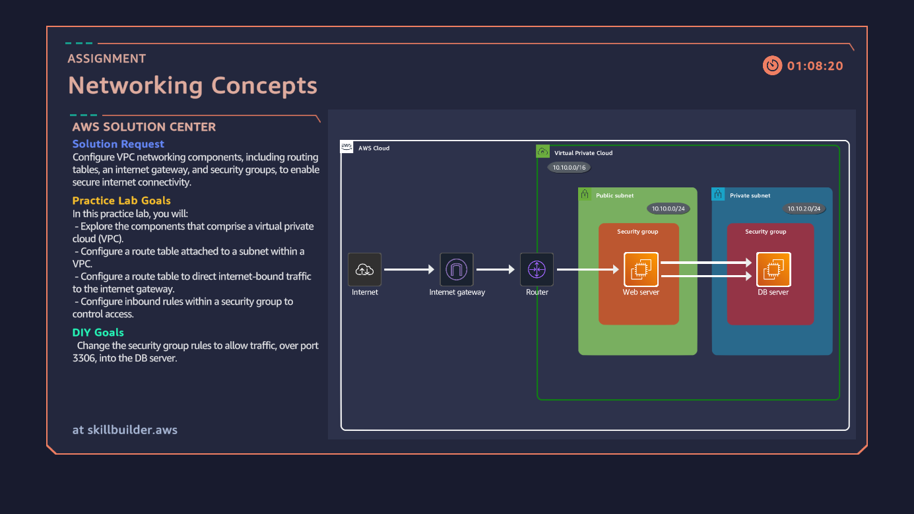
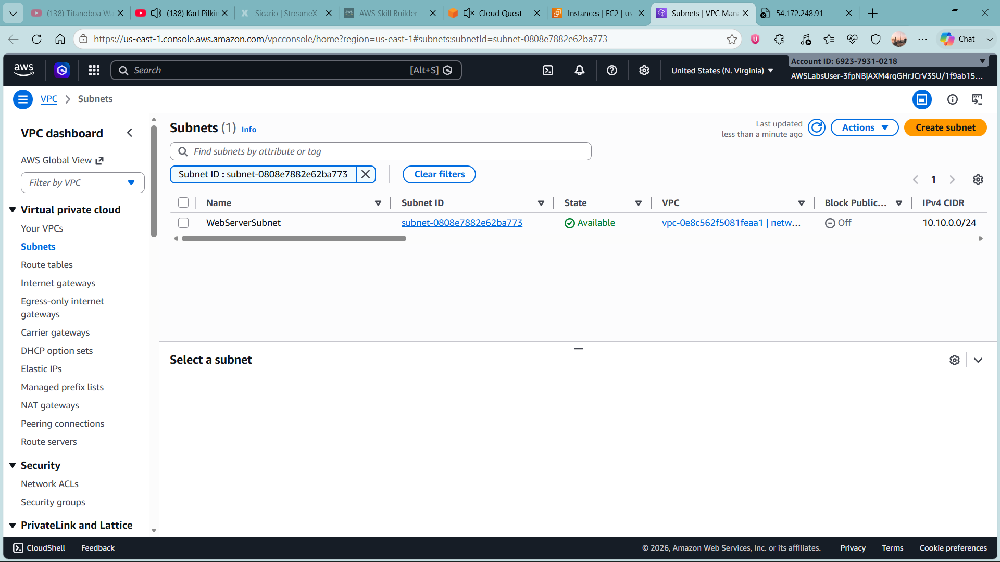

# aws-vpc-networking-security
A hands-on AWS lab documenting VPC networking, public and private subnets, route tables, internet gateway configuration, security groups, and troubleshooting internet connectivity.

# AWS VPC Networking and Security Lab

## Project Overview

This project explores the configuration of Amazon Virtual Private Cloud (VPC) networking components to enable controlled internet connectivity for cloud-hosted resources.

The lab focuses on route tables, internet gateways, subnet associations, and security group rules. It also demonstrates a practical troubleshooting scenario in which an initial attempt to access a web server resulted in a connection timeout.

The objective is to understand how routing and security controls work together to provide connectivity while limiting unnecessary network exposure.

## Objectives

* Explore the components of an Amazon VPC.
* Configure a route table associated with a public subnet.
* Direct internet-bound traffic through an internet gateway.
* Configure security group inbound and outbound rules.
* Investigate and troubleshoot a web server connectivity timeout.
* Understand the difference between public and private subnet designs.

## AWS Services and Components

| Component        | Purpose                                                                                                    |
| ---------------- | ---------------------------------------------------------------------------------------------------------- |
| Amazon VPC       | Provides a logically isolated network environment.                                                         |
| Public subnet    | Hosts resources intended to be reachable from the internet when appropriately configured.                  |
| Private subnet   | Hosts resources that should not be directly accessible from the public internet.                           |
| Route table      | Determines where network traffic is directed.                                                              |
| Internet gateway | Enables communication between a VPC and the internet when routing and addressing are configured correctly. |
| Security group   | Controls permitted inbound and outbound traffic for associated resources.                                  |
| Amazon EC2       | Provides the virtual server used to test connectivity.                                                     |

## Implementation

### 1. Investigate the Initial Connectivity Issue

Selected the Web Server EC2 instance and copied its public IPv4 address.

The initial attempt to access the server resulted in a timeout.

This indicated that connectivity required further investigation. A timeout alone does not identify the root cause, so the VPC routing and security configuration needed to be reviewed.

### 2. Inspect the VPC and Subnet

Opened the VPC console through the web server's subnet information and examined the associated route table.

This step helped establish how the subnet directed traffic and whether an internet gateway route was present.

### 3. Configure the Route Table

Edited the route table associated with the WebServerSubnet.

Configured the following route:

| Destination | Target                       |
| ----------- | ---------------------------- |
| `0.0.0.0/0` | Internet gateway (`igw-...`) |

The default route directs IPv4 traffic destined for addresses outside the VPC's more specific routes towards the internet gateway.

For internet connectivity to work, the subnet must use this route table, the internet gateway must be attached to the VPC, and the EC2 instance must have a public IPv4 address or another suitable internet-facing address configuration.

### 4. Configure the Web Server Security Group

Updated the security group associated with the Web Server instance.

**Inbound rule**

| Type | Protocol | Port | Source      |
| ---- | -------- | ---- | ----------- |
| HTTP | TCP      | 80   | `0.0.0.0/0` |

This rule allows HTTP requests from any IPv4 address. It is appropriate only when the web service is intended to be publicly accessible.

**Outbound rule**

Reviewed and configured an outbound rule allowing all traffic to `0.0.0.0/0`.

This permits outbound IPv4 traffic from the instance, subject to other applicable network controls. Broad outbound access should be restricted when application requirements allow.

### 5. Validate Connectivity

Returned to the EC2 console and retrieved the Web Server's public IPv4 address for a follow-up connectivity test.

The final validation should confirm whether the web application responds successfully over HTTP and whether the expected page loads.

A successful configuration change should not be treated as proof of restoration until connectivity has been tested.

## Intended Network Architecture

The intended design separates internet-facing web resources from private database resources.

* The web server resides in a public subnet.
* The public subnet uses a route to an internet gateway.
* The web server security group permits inbound HTTP traffic on TCP port 80.
* The database server resides in a private subnet without a direct internet gateway route.
* The database security group permits database traffic on TCP port 3306 from the web server's security group rather than from the entire internet.

The database access rule describes the intended architecture. It should be marked as implemented only after it has been configured and verified in AWS.

## Skills Demonstrated

### Cloud Networking

* Understanding VPCs, subnets, and network segmentation.
* Configuring and inspecting route tables.
* Understanding default routes and internet gateways.
* Distinguishing public subnet connectivity from private subnet isolation.

### Network Security

* Configuring inbound and outbound security group rules.
* Understanding TCP ports and service-specific access.
* Applying the principle of least privilege.
* Recognising the importance of restricting database access.

### Troubleshooting

* Investigating an initial web server connection timeout.
* Reviewing routing and access-control configuration.
* Identifying configuration components that can affect connectivity.
* Validating changes through connectivity testing.

### Cloud Operations

* Navigating AWS networking and EC2 consoles.
* Inspecting relationships between instances, subnets, route tables, and security groups.
* Documenting configuration changes and validation results.

## Lessons Learned

Cloud connectivity depends on several components working together. A public IPv4 address alone does not guarantee that a server is reachable from the internet.

The subnet's route table, internet gateway attachment, security group rules, instance configuration, and application service must all support the intended connection.

The lab also highlights the importance of separating public-facing services from private backend resources and restricting database access to trusted application components.

## Future Improvements

* Verify the final HTTP connection and document the actual result.
* Configure and test a private database subnet.
* Restrict database access to the web server's security group on TCP port 3306.
* Review network ACLs and host-level firewalls if connectivity remains unsuccessful.
* Add a network architecture diagram and screenshots of the final configuration.
* Recreate the environment using AWS CloudFormation or Terraform.

